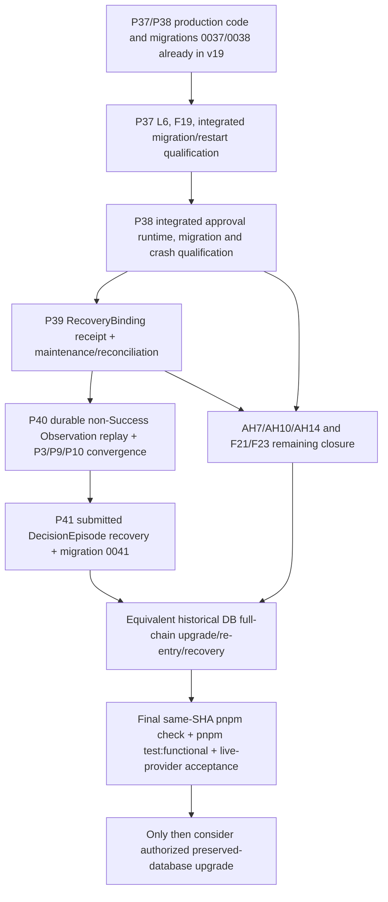

# Full Delivery Gap and Acceptance Matrix

Status: **OPEN — planning audit only; not a design contract, implementation authorization, or release declaration.**

Audit baseline: `24598bbeba0dac6d1901f1f1781f7eb2c59a7f76` (`v19` candidate), audited 2026-10-12. The previously inspected source worktree was at `ed5fba00ee60e169cadf0df12395179862abd1e8`, whose only difference from this baseline was `tests/p9-acceptance.test.ts`; this matrix worktree starts at the exact baseline.

This document inventories delivery evidence against the latest accepted Problem & Goals v1.3, Scenarios S1–S4 v1.3, System Design v1.14, and Detailed Implementation Design v1.37 present at the baseline. It does not create or settle semantics. A referenced branch commit or test source is not treated as integrated implementation or passing evidence unless the record says so and its commit is in the audited baseline. Where a required decision is absent, the completion criterion is to obtain the owning governance decision before implementation.

## Evidence levels

- **Source** means code or test source exists; it does not prove behavior.
- **Focused** means a named unit/integration/process/browser selection passed on its recorded candidate.
- **Full gates** means both `pnpm check` and `pnpm test:functional` reached terminal success on the same exact code SHA.
- **Real-provider** means an explicitly named live provider/profile journey passed; scripted HTTP test providers do not count.
- **Migration qualification** means forward upgrade, re-entry, data preservation/disposition, interruption/restart, and integrity were checked on an equivalent historical fixture. A fresh database smoke is not migration qualification.

Full completion requires every applicable row below to meet its criterion, all governance blockers to be resolved by the owning authority, the latest candidate to pass the full gates, and old-database upgrade to pass on an approved equivalent fixture before any preserved user database is touched.

## Delivery matrix

| Module / contract owner | Latest accepted contract and evidence identity | Integrated implementation state at v19 | Evidence level at v19 | Open gap, authorization, or distinction | Completion criterion and dependencies |
|---|---|---|---|---|---|
| Goals, user scenarios, system semantics | Problem & Goals v1.3; Scenarios v1.3; System Design v1.14; DID v1.37 | Frozen target is explicit: G1–G8 and S1–S4. This matrix adds no semantics. | Source-of-truth documents present. | `AGENTS.md` introductory version labels are stale. If implementation cannot satisfy frozen goals, raise the gap to its owning governor; do not redefine goals here. | Use the current document chain as acceptance oracle for all rows. |
| Project, Root Conversation, Workspace, Work, governance | MAC / CRAC / CAPA accepted contracts; MAC proposal SHA `44B549EA81E21B3D4BE5D545EA446B544D50CCA0061C83E6FC40CDC2ADCCA932`; FT-DG-02 SD v1.10 / DID v1.32 | Root Work start, pending proposal governance, exact approval, Work lifecycle, independent Verification and Parent Acceptance are implemented. | MAC phase reports; included in ancestor full-gate candidates 6ee3ccd and 8bc25c2; user-facing cases covered by functional/browser suites. | The aggregate release claim remains blocked by other rows. P15 is local single-user; multi-subject visibility is explicitly outside P36's qualification. | Re-run on final integrated candidate; if multi-subject behavior is required, obtain a separate contract and qualification scope. |
| Agent loop, context, Session and durable handoff | DID v1.20–1.21 (AHT / ALS); SCRC and P17 accepted owner contracts | AgentLoopStep, Session/Context Runtime, response delivery and much of AH1–AH6/AH8–AH13 are implemented. | SCRC/P17 completion records and focused crash tests; older `SCRC-008.result.md` claims closure, but later P36 review says current AH15–AH19/SCRC closure remains open. | Do not promote the old SCRC closure record over later recovery evidence. AH14 remains partial; P41 recovery is only on separate branches/preintegration. | Resolve and qualify every applicable AH branch on the integrated schema/runtime, then reconcile any superseded SCRC claim with evidence. |
| Parent/Child organization, Dependency, Deliverable, Acceptance | MAC-P2/P3 accepted contracts; P7/P8 contracts; P37 P9/P10 DeliverReplay contract | **P37 production paths and migration 0037 are integrated in v19**; `P38_MIGRATIONS` includes `P37_MIGRATIONS`. Formation, parent acceptance, dependency declaration, deliverable production/delivery, satisfaction and wake are implemented. | MAC-P2/P3 phase evidence; earlier F18/F19 public cases. P37's 10-file / 43-test L1 run was on independent candidate `0580e454729da39e9ed7eec187938ce9528122fd`, **not an ancestor of v19**, so it is not integrated v19 qualification. | P37 Layer 6 real-process crash/restart matrix and F19 rerun remain pending. `P37-L6-process-crash-matrix-checkpoint.result.md` is test-source only and explicitly says no Vitest/process/full gate was run. | Keep P37 code/migration as integrated; run L6 and F19 on the exact v19-derived P37/P38 candidate, including full restart/migration behavior, then full gates. |
| Executable tool approval and P38 recovery | P4/P12 accepted approval contract; P38 candidate baseline `e1f07b37291b9521cc5dffdf708a65da0efd7816`; P38 promotion record `ec79ad0` | **P38 production runtime and migration 0038 are integrated in v19**; `CURRENT_MIGRATIONS = P38_MIGRATIONS`. P38 request/decision/TTL/replay path exists. Scoped public/browser cases exist. | Focused public process 4/4 and browser 1/1 were reported on the v5 candidate; they do not establish full P38 qualification on exact v19. The code base SHA is an ancestor of v19. | Integrated 0036→0038 migration/restart/crash matrix and full gates remain unqualified in the P38 checkpoint. Approval consumption still must bind to durable P39 RecoveryBinding. | Do not schedule source integration of P37/P38 as outstanding. Finish P37 L6/F19 and qualify P38 migration/crash paths on one exact v19-derived candidate; then integrate P39 receipt. |
| P39 maintenance and reality reconciliation | Accepted P1/P4/P9 RecoveryBinding/reconciliation contracts; independent latest P39 branch commit `9533b3569f121cca0a33e79293ee1db77d692ba5`; reality-proof branch `ee098f93960bbdcc249ea581865ad62255eb81e1` | **Independent branch implementation only; not in v19.** P39 source adds protected maintenance/write exclusion, blocker reports, candidate `ReconciledNoEffect`, and a fail-closed runtime seam. | Static typecheck/Biome only in the P39 checkpoint; process/migration/Vitest/full gates not run. A writer-exclusion process test exists as source but was not run. | P39 checkpoint explicitly lacks integrated P37/P38 descriptors; receipt persistence remains unintegrated; current binding v1 lacks an accepted visibility-scope digest; no external reconciliation profile is registered. Windows VFS/I/O/power-loss qualification is open. Do not call the candidate an authoritative negative result. | Integrate only after ordered owner contracts/migrations; persist P38 consumption receipt atomically; decide any required binding-v2 semantics through governance; qualify supported storage/deployment profile and full runtime. Depends on P38 and P37 prefix. |
| P40 non-Success Observation replay | Accepted AH7-DG-01/P39–P40 owner landing; package SHA `5B61E0FF922A10D225FD5DAEA00176BD16C5C0B39484D626B7FEF6340516373A`; preintegration commit `78e8287cae3357ce8ff72a3bcf79438bf4edf6a9` | **Source preintegrated in a separate branch only; inactive in v19 and in preintegration.** P40 evidence/replay store, Attention path and migration source exist. | Typecheck/Biome only on preintegration; pending process test source not executed. Migration descriptor is exported but not in runnable migration lists. | P39 selected fact is not wired through terminal P40 transaction into P3 ToolResult/Session/Action/cursor. No production P40 activation, default-suite promotion, process qualification, or recovery rebuild qualification. Accepted contract landing did not itself authorize implementation/activation. | Integrate the ordered P37–P39 schema prefix, connect P39 evidence to P40 without changing selection ownership, qualify P4→P3 atomic/replay behavior and P9/P10 Attention/rebuild, then promote and run full gates. |
| P41 submitted DecisionEpisode binding integrity | Accepted P41 decision-binding landing SHA `10D5A2532810B65DFBD3E397B141F6C0765AD32F4992BDDD0FE17F468975339A`; runtime branch commit `0853b67d55280a75c29941ceb33ca1110919b501`; test follow-up `902ed5f238e084686d7def6bfa2ce25f74eeead4` | **Independent source only; not in v19.** P3/P9/P10 mismatch classification, audit fact and stop-close plan exist on branches. | Static typecheck/Biome only; pending tests unrun. No 0041 migration body/registration. | Latest P41 checkpoint requires the full 0036→0040 qualified prefix before 0041. Unresolved P4 effects must block close; no AH10 closure can be inferred. | Complete and qualify P37–P40 first, add accepted 0041 migration, test live lease / stop / unresolved-effect / settled-orphan cases, public Attention, restart and full gates. |
| Old database upgrade and legacy adoption | P9 `07` §3/AH14; SCRC/P17 migration contracts; migrations through 0038 in P38 checkpoint | Forward-only migrations and many historical fixtures exist; legacy adoption has positive equivalent-fixture evidence. | P9/SCRC historical migration tests; F20 clean-checkout smoke uses a fresh isolated DB, not a preserved user DB. P38 explicitly states migration 0038 was not applied to the preserved database. | AH14 is partial: ambiguous old success evidence with actions lacks durable public Attention (AH14-DG-01). Current full-chain 0036→0041 is not qualified; P39–P41 cannot run on an incomplete or unqualified prefix. Preserved dogfood DB remains read-only absent required authorization/evidence. | Build an equivalent fixture from the actual supported historical schema/data versions; verify every ordered migration, re-entry, data/identity/reference preservation, ambiguous-row fail-closed disposition, interruption/restart, backup/restore and integrity. Obtain authorization before any preserved-data migration. |
| F21 project resource admission | Accepted FT-DG-01 owner amendment in DID v1.35; accepted functional proposal SHA recorded in `F21-F23-isolated-integration.result.md`; OPEN-3 result/review | Profile-based resource selector, activation intent/recovery and forged-path rejection are integrated in the F21 candidate. | Focused F21 tests; later full integrated 8bc candidate includes F21 public/browser cases. | F21 remains open for OPEN-1 Profile-source audit and OPEN-2 historical CreateProject v1 same-ID replay. OPEN-3 alone is not F21 closure. | Close both remaining owner questions/qualifications; integrate and include in current full gates and clean-clone upgrade path. |
| F23 command codec and receipt integrity | Accepted external codec amendment and exact-tuple owner contract; acceptance SHA `DD24C9550BFE253D94DE7236255E5E8E710A7E612A57607E474E8A90653529FC` (recorded in Wave 4); implementation integration reports in `F21-F23-isolated-integration.result.md` | Strict input codec and exact-tuple receipt precedence have implemented paths. | F23 Wave 4 public slice and 8bc full gates pass for the included cases. | Separate current RED/pending work covers malformed stored result/rejection shapes and prior-receipt decoding; those cases are outside default gates. P10 durable Attention for generic corruption and cross-version receipt decoder policy are still open. | Resolve owner decisions; implement strict stored-result decoders and recovery disposition; promote RED cases only after they pass; include two-process and historical-receipt fixtures in full gates. |
| Web/product UI | D-1 through D10; final Web closure record at `7752e0e5bba1cf4ffd7351895c1e405bb7158855` | Web v1 implementation is formally closed; F22 is included in the later default browser qualification. | D10 closure plus browser results in earlier full integrated candidates. | UI closure does not close backend F21/F23, P37–P41, existing-data upgrade, or real-provider recovery. | Requalify final integrated UI/backend together, including approval, Work Detail, resource selection, restart and route/session isolation. |
| Real-model behavior / provider qualification | DID provider contracts and capability qualification artifacts; named provider records in `planning/testing/provider-qualification/` and `planning/testing/core-capability/` | Real-provider B01/B03/B07/B08/B09/B11 phase scenarios have historical evidence. | Real-provider evidence is scenario/profile-specific and from earlier candidates; the full P36/8bc functional suites use isolated HTTP provider boundaries, not a live model. | Must not present scripted HTTP-provider functional success as current real-model behavior. Latest candidate needs a versioned deployment/profile fingerprint and representative S1–S4 tasks, restart/resume, approval and failure recovery. | Run the named live provider acceptance set on the final integrated candidate/configuration and retain request/response qualification evidence without secrets. |
| Full gates and current hard blockers | P36 full-gate result at `6ee3ccd9248defae439e57f01cc4b339cc32d641`; F21/F23+P12/P4 full qualification at `8bc25c25c78700f278cfc03a6247aa7b86a59727` | Earlier ancestor candidates passed full gates. Both tested SHAs are ancestors of the v19 baseline. | Historical full-gate evidence only; no full gates on `24598bb` or exact v19 integrated P37/P38 recovery candidate. | Release integrator reports the **current full run is red in P9 Story C and provider runtime**. The cited tests are `tests/p9-acceptance.test.ts` and `tests/provider-runtime-phase1.integration.test.ts`. Existing older focused records report Story C fixture repair and provider 25/25, but they do not clear a newer full-run failure. This is an explicit blocking item; record exact candidate, terminal output and diagnosis before closure. | Diagnose and fix without weakening frozen assertions; rerun `pnpm check` and `pnpm test:functional` on the same exact final SHA, including F20 clean clone and all newly promoted process/browser cases. |

## Dependency DAG and execution order

This sequence records necessary integration dependencies, not a new design authorization:

P39/P40/P41 source currently depends on a contract-backed reconciliation/evidence handoff and an ordered migration prefix. P41 explicitly requires qualified 0036→0040 before 0041. The graph must be read per checkout, not as one sequential release history: `C:\Arbor@f80ee9132774c0c1fb570744d81398fad17da188`, the v19 line through `24598bb`/`ed5fba0`, and P37–P41 batch `001a23df7d0acd1ddadaba4a9fcfbdad3f0d5fb4` are separate checkout positions. In particular, `001a23` is based on `0580e45`, is **not an ancestor of v19**, and has preintegration-only source; v19 itself already contains P37/P38 production code and registered migrations 0037/0038. The batch record says P40 migration is inactive and P41/0041 is not registered. Do not infer P39/P40/P41 integration into v19 or transfer qualification across these non-linear candidate lines.

## Evidence index and reporting rules

Key records at or referenced from the audit baseline:

- `planning/results/P36-integrated-full-qualification.result.md` — full gates on 6ee3ccd; scope explicitly leaves P37–P41 and broader recovery open.
- `planning/results/P36-integrated-full-qualification.review.md` — evidence consistency review; explicitly notes no P37–P41 phase files in that reviewed tree.
- `planning/results/P37-layered-qualification.result.md` and `planning/results/P37-L6-process-crash-matrix-checkpoint.result.md` — P37 L1 pass, L6 source-only/pending, F19 pending.
- `planning/results/P38-expiry-and-replay-runtime-checkpoint.result.md` and `planning/results/P38-layered-executable-approval-qualification.result.md` — implementation checkpoint and scoped public/browser pass; full migration/runtime qualification remains open.
- `planning/results/P39-maintenance-runtime-checkpoint.result.md` at branch `9533b3569f121cca0a33e79293ee1db77d692ba5`; `planning/results/P40-P41-preintegration.result.md` at `78e8287cae3357ce8ff72a3bcf79438bf4edf6a9`; `planning/results/P41-runtime-implementation-checkpoint.result.md` at `0853b67d55280a75c29941ceb33ca1110919b501` — separate worktree checkpoints, not v19 integration or qualification.
- `planning/results/AH7-partial-crash-qualification.result.md`, `planning/results/AH10-generation-command-takeover-gap.result.md`, `planning/results/AH14-legacy-adoption-partial.result.md` — open crash/recovery scope.
- `planning/results/F21-F23-P12-P4-integrated-full-qualification.result.md`, `planning/results/F23-exact-tuple-receipt-integrity.result.md`, `planning/results/FT-DG-02-work-detail-implementation.result.md` — distinguish F21/F23 remaining items from closed F22.
- `docs/design/implementation/P9/07-agent-loop-step-recovery.md` — frozen AH recovery and legacy-adoption acceptance contract.

Historical results do not erase later failures. In particular, the Story C fixture migration record (`planning/results/AH7-DG03-P9-runtime-fixture-compatibility.result.md`) reports a focused pass but explicitly did not run full gates; the provider deadline record (`planning/results/provider-runtime-deadline-test-oracle.result.md`) reports focused and prior full-check passes. Both must be reconciled against the release integrator's newer full-run RED before claiming a green candidate. Keep exact SHA, command, test counts, and failure disposition with every new gate result.
